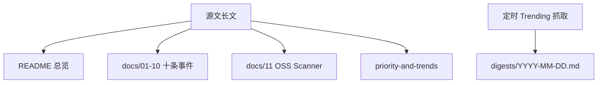

# 源文：2026 年 10 月中下旬安全事件梳理

| 字段 | 值 |
| --- | --- |
| 标题 | 2026 年 10 月中下旬安全事件梳理 |
| 作者 | 陈成（sorrycc） |
| 发布 | 2026-10-22 |
| 覆盖 | 2026-10-08 至 2026-10-22 公开的安全事件 |
| 链接 | https://research.sorrycc.dev/@sorrycc/2026-10-security-incidents |

## 材料与可信度（原文）

- 材料：厂商/项目官方公告、安全研究机构分析、相关 X 线程与 GitHub issue/PR，以及一篇微信综述（已逐项核实）。
- 标注：**已确认** / **二手** / **未证实**。

## 摘要（四条）

1. **造成实际损失的主要是凭据泄露。** Zeabur（明文、永不过期管理令牌）、LiteLLM（被盗 GitHub CLI OAuth）、OpenCode Console（托管第三方 API Key）、TiDB Cloud（被盗服务账号）都是凭据泄露后横向放大。PHP / Node.js / GitLab 的 RCE 关注度更高，但已确认损失主要来自凭据类事件。
2. **PHP 核心 RCE 已有在野利用尝试与公开 PoC**，是本期唯一确认被利用的软件漏洞；公开 PoC 目前多在 ARM64 或关 ASLR 的 x86-64 上稳 RCE。
3. **eMudhra 中间 CA 风险在浏览器以外**（运行时、OS 工具、代理/VPN、IoT）；mitmproxy 已加 `--emudhra`。
4. **发现与利用都在加快**（AI 扫描、补丁比对）；属趋势判断，原文称暂无量化数据支撑。

## 结构映射

本语料各专题只复述源文已写内容；扩展阅读请回源文「来源」一节。
