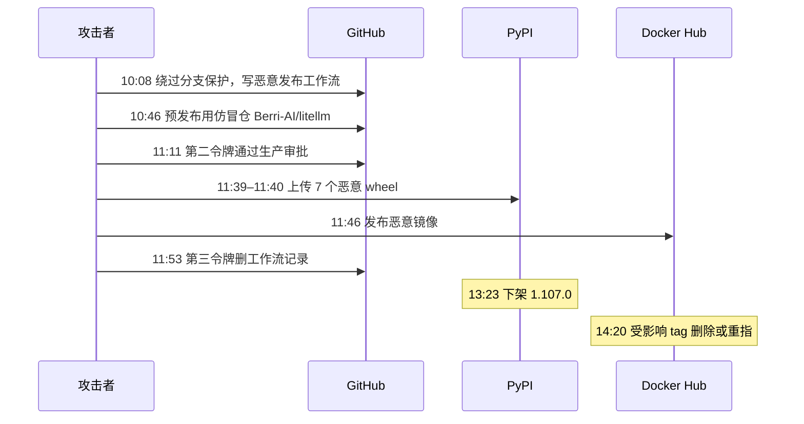

# 2. LiteLLM 1.107.0 供应链投毒

**来源：** [sorrycc 2026-10 梳理 §2](https://research.sorrycc.dev/@sorrycc/2026-10-security-incidents)  
**可信度：** 已确认（JFrog、Chainguard、The Hacker News、LiteLLM 官方）

## 概况

**10-21** 发布的 LiteLLM **1.107.0** 为恶意版本，PyPI 与 Docker Hub 均受影响。这是 LiteLLM **今年第二次**被投毒（3 月为 1.82.7 / 1.82.8）。

## 关键事实

- **制品：** PyPI 上 7 个 wheel 全部含恶意代码；Docker `latest` / `main-latest` / `main-stable` 约 3 小时内指向恶意镜像。
- **执行：** 通过 `cook.pth` 在**任何** Python 解释器启动时执行，**不需要** `import litellm`。
- **窃取：** 云凭据、SSH/GPG、浏览器数据、环境变量、20 余种 AI 编码工具配置、LiteLLM 代理中上游 API Key；并每小时拉取执行远程代码。
- **攻击路径（官方，更新至 10-21 20:30 UTC）：** 攻击者持有三名工程师的 GitHub CLI OAuth；其一为组织所有者（关分支保护、force push 修改发布工作流）；其二满足生产审批；其三删除工作流记录。恶意制品由仿冒仓 `Berri-AI/litellm`（正牌 `BerriAI/litellm`）构建；官方 v1.107.0 **源码 tag 无恶意文件**。
- **令牌来源（官方推测，未确认）：** 公网暴露的内部部署；Claude Code 某些情况下把 GitHub CLI OAuth 写入响应体，记录响应体的 LiteLLM 会把令牌落日志；疑入口为「最近修补的漏洞」。仅解释其中一个令牌；另两个仍在查。
- **归因：** 官方未点名。CERT-EU 曾将 3 月投毒归于 TeamPCP；本次尚无归因。

## 时间线（10-21 UTC，据官方）

| 时间 | 事件 |
| --- | --- |
| 10:08 | 特权令牌绕过分支保护，写入修改后的发布工作流 |
| 10:46 | 预发布使用仿冒仓 `Berri-AI/litellm` |
| 11:11 | 第二令牌通过生产审批 |
| 11:39–11:40 | 7 个恶意 wheel 上传 PyPI |
| 11:46 | 发布含恶意内容的 Docker 镜像 |
| 11:53 | 第三令牌删除工作流记录 |
| 13:23 | PyPI 下架 1.107.0 |
| 14:20 | Docker Hub 受影响 tag 删除或重新指向 |

事后：已从 PyPI / Docker Hub / GHCR 移除恶意制品，吊销令牌，移除 trusted publishing，组织成员缩减至一名未受影响用户。

## 处置（原文）

1. 全主机 / CI / 镜像：`pip show litellm`，site-packages 搜 `cook.pth`。  
2. 10-21 拉过浮动 tag 的核对镜像 digest。  
3. 命中 → 视为该机全部凭据已泄露：干净环境吊销重签，隔离或重建。  
4. 按 digest 锁定 **1.106.2**。  
5. 自建代理若记响应体：查日志中 `gho_` 令牌；有则吊销，关响应体日志或脱敏。
