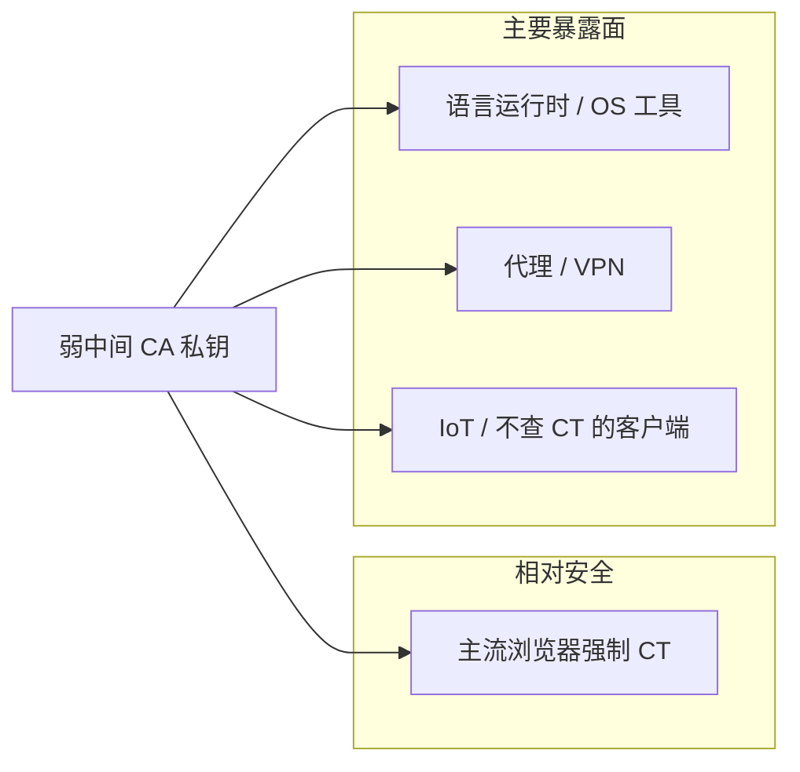

# 4. eMudhra 中间 CA 私钥可推算

**来源：** [sorrycc 2026-10 梳理 §4](https://research.sorrycc.dev/@sorrycc/2026-10-security-incidents)  
**可信度：** 已确认（Cisco Talos、Go 安全公告、eMudhra 自查站、各浏览器封锁记录）

## 概况

eMudhra **8 张中间 CA** 使用极弱 P-384 私钥（部分仅为个位或两位数），任何人可从公开证书推算私钥。出问题的是**中间 CA**，不是根证书。

## 技术细节

- 6 张 TLS 中间 CA（挂在 emSign Root TLS CA - G3）+ 2 张代码签名中间 CA（emSign Root CS CA - G3）。
- 根因：2025-04-30 为 24 张子 CA 生成密钥的仪式中，wrap/unwrap 多生成一套弱密钥并被误用。
- 对比 DigiNotar（2011）：彼时 CA 被入侵后签发伪造证并用于伊朗 MITM；本次**无需入侵**，私钥对任何人公开可得。

## 时间线

| 日期 | 事件 |
| --- | --- |
| 10-17 | 报告各根证书计划；Firefox、Chrome 当天封锁 |
| 10-19 | 通知下游；Apple 封锁 |
| 10-20 | Microsoft 封锁（含 2 张代码签名 CA）；社区自查站上线 |
| 10-21 | Node.js、Go 发版；Talos 分析；mitmproxy 合并 `--emudhra` |

## 影响边界

- **浏览器：** 强制 CT，即使不更新封锁列表，伪造证也过不了。
- **非浏览器：** 不查 CT、不用吊销数据的客户端是主暴露面。实测：10-21 用 `EM DV TLS CA - G3B` 签的 `localhost` 可通过某 Linux 自带 curl 8.21.0 + 系统 CA。
- **macOS：** 系统 `curl`/`git`/`python3` 等读的 `/etc/ssl/cert.pem` 尚未更新；自带 `pip3` 用内置旧根。
- **代码签名 / 固件：** 有观点称可为恶意固件签名；原文：固件验签多依赖 ROM 固化根，很少用公共 CA；**目前无证据支持该场景**。
- **利用门槛：** mitmproxy PR #8500（10-21 23:36 UTC）新增可选 `--emudhra`；未默认内置这些证书。Talos 截至 10-21 14:00 UTC **未观察到在野滥用**。

## 修复进度（自查站更新时）

- **已修：** curl、Go（1.27.3 / 1.26.10，CVE-2026-111943）、Java、Node.js、Python certifi、Rust 工具链、Electron、Docker Desktop、Claude Code 2.1.303。
- **待修：** Bottlerocket、Bun、Erlang certifi。

## 处置（原文）

1. 浏览器无需额外操作。  
2. macOS：用自查站测试主机跑 curl，握手失败才说明正确拒绝。  
3. Linux：发行版更新；Go 用 1.27.3 / 1.26.10 重编译；Python 升 certifi。  
4. VPN / 代理 / IoT 逐一确认厂商；不再更新的设备列入隔离或替换。

## 常见误读

- CVE-2026-111943 是 **Go** 的证书封锁编号，不是 PHP/Node/Java 共同漏洞。  
- 「私钥为 4」来自社区，官方材料未公布。  
- 「8 个中级根」应为 **8 张中间 CA**。
