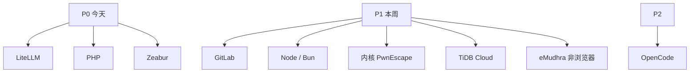

# 处置优先级与趋势判断

**来源：** [sorrycc 2026-10 梳理](https://research.sorrycc.dev/@sorrycc/2026-10-security-incidents)（「趋势判断」「处置优先级」「待确认事项」）

## 处置优先级

| 优先级 | 事项 | 原因 | 详见 |
| --- | --- | --- | --- |
| P0（今天） | LiteLLM 1.107.0 排查与凭据重建 | 已确认投毒，窃取凭据 | [§2](02-litellm-supply-chain.md) |
| P0（今天） | PHP 升级或缓解 | 已有在野利用 | [§1](01-php-rce.md) |
| P0（今天） | Zeabur 用户凭据轮换与追溯 | 已确认数据读取 | [§3](03-zeabur-breach.md) |
| P1（本周） | GitLab 自建实例升级 | CVSS 10.0；10-12 补丁不覆盖 | [§6](06-gitlab-cve.md) |
| P1（本周） | Node.js 升级、Bun → 1.4.4；优先外部抓取类服务 | Brotli RCE | [§5](05-nodejs-bun-brotli.md) |
| P1（本周） | 不可信客户机的 KVM / Firecracker 宿主机升内核 | CVSS 9.3 客户机逃逸 | [§8](08-pwnescape.md) |
| P1（本周） | TiDB Cloud 管理 API Key 轮换 | 已确认数据被复制 | [§10](10-tidb-cloud.md) |
| P1（本周） | 非浏览器 TLS 客户端信任库核查 | 公开工具已支持利用 | [§4](04-emudhra-ca.md) |
| P2 | OpenCode Console Key 吊销 | 可能暴露 | [§7](07-opencode-console.md) |
| 长期 | 组件清单与凭据治理 | 见下 | — |

## 长期措施（原文）

1. 维护组件清单：实际运行版本、维护状态、升级路径、能否隔离。  
2. 明文长期凭据 → 短期、可轮换、最小权限；管理凭据异常使用告警。  
3. 客户自主掌握的离线或跨供应商备份，并定期验证恢复。  
4. 对外部漏洞报告建立复现、去重、定级的分诊流程。

## 趋势判断（原文）

1. **凭据是主要攻击面。** 长期有效、明文、权限过宽的凭据一旦泄露即横向放大。Zeabur 攻击持续 16h 无告警 → 管理凭据异常检测普遍不足。  
2. **补丁到利用窗口缩短甚至倒置。** PHP 细节禁运前一天流出；据转引 AWS，利用尝试早于补丁四天；补丁当天大面积扫描与数百 PoC；mitmproxy 在 eMudhra 公开后 4 天内内置利用选项。  
3. **停止维护组件风险上升。** Node 20/25、PHP 8.1 及更早、不再更新信任库的 IoT，本期处于无补丁或滞后。  
4. **AI 同时加快找洞与利用。** OSS Scanner 11 天报出 880 个模型评级高危以上；早期抽样误报约 1%；GitLab 10.0 来自同一研究者一个月内第四个同类问题；有人公开称借助大模型把验证型 PHP2Shell PoC 补全为可执行命令版。利用侧加速目前只有个案，无量化数据。  
5. **AI 工具本身成为凭据泄露新渠道。** LiteLLM：AI 编码工具把 GitHub 令牌写入响应体 → 网关日志 → 公网暴露部署（官方推测）。Agent / 网关 / 日志间的令牌流转需纳入凭据治理。

## 待确认事项（10-22 核查后）

| 事项 | 状态 | 结论 |
| --- | --- | --- |
| PHP 公开 PoC 是否已流出 | 已解决 | 已流出；少数有效；公开版尚不能在开 ASLR 的 x86-64 上 RCE |
| PHP「补丁不完整」来源 | 已解决 | 无机构称补丁失效；来自 Datadog 对残留模式的风险提示 |
| Zeabur 初始入侵途径 | 仍未确认 | 无直接证据；等 GitHub Support |
| Zeabur DB 实际外传量 | 无法确认 | 审计无输出；已知上限每表 5 万行 |
| LiteLLM 令牌来源 | 部分解决 | 推测公网内部部署日志；只解释一个令牌 |
| TiDB 真实性与范围 | 部分解决 | PingCAP 已确认事件与数据类别；10.6TB / 明文 Key 未证实 |
| OSS Scanner 数字 | 已解决 | 650 / 114 来自团队成员；早期 97 中 1 误报 |
| CVE-2026-99999 一手公告 | 已解决 | 内核 CNA 已发，CVSS 9.3；NVD 未完成分析 |
| Bun Brotli 修复版 | 已解决 | Bun v1.4.4 |

### 仍需跟进（原文）

- Zeabur 报告后续与 GitHub Support 回复  
- LiteLLM 另两令牌途径与内部部署入口漏洞  
- PingCAP 客户影响通知；对 FulcrumSec 已公开数据的核实  
- AWS 关于 PHP 10-17 即遭利用的原始通报（目前仅 Datadog 转引）  
- 公开 PHP PoC 何时能在开 ASLR 的 x86-64 上稳 RCE  
- 内核 IPv4 入口校验后续补丁  
